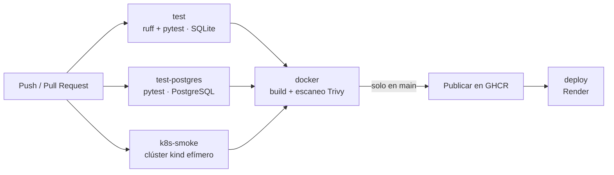

# Tasks API · CI/CD de extremo a extremo

[](https://github.com/carlos-vi/tasks-api-cicd/actions/workflows/ci.yml)


API REST de gestión de tareas construida como **proyecto de aprendizaje de CI/CD**. La aplicación es deliberadamente sencilla: lo importante es el ciclo completo que la rodea, desde un `git push` hasta un despliegue en producción, pasando por tests, escaneo de seguridad, contenedores y orquestación.

## Qué demuestra este proyecto

- **Integración continua** con GitHub Actions: lint, tests con SQLite y con PostgreSQL real, y prueba de despliegue en un clúster de Kubernetes efímero.
- **Contenedores** con Docker: imagen propia, construcción con caché de capas y entorno completo con Docker Compose.
- **Seguridad en el pipeline**: escaneo de vulnerabilidades de la imagen con Trivy antes de publicarla.
- **Entrega continua**: la imagen se publica en GitHub Container Registry y se despliega automáticamente en Render.
- **Flujo de trabajo de equipo**: rama `main` protegida, cambios mediante *pull request* y checks obligatorios.
- **Kubernetes**: manifiestos para la API (2 réplicas, sondas de salud) y PostgreSQL con almacenamiento persistente.
- **Interfaz web** sencilla (HTML, CSS y JavaScript sin dependencias) servida por la propia API en `/`.

## Arquitectura del pipeline



En una *pull request* se ejecutan las pruebas y el escaneo, pero **no** se publica ni se despliega nada. Esas dos acciones solo ocurren cuando el código llega a `main`.

## Stack

| Capa | Tecnología |
|---|---|
| API | Python 3.11 · FastAPI · Uvicorn |
| Persistencia | SQLAlchemy 2.0 · SQLite (por defecto) · PostgreSQL 16 |
| Tests y calidad | pytest · Ruff |
| Contenedores | Docker · Docker Compose |
| Orquestación | Kubernetes (manifiestos en `k8s/`) |
| CI/CD | GitHub Actions · Trivy · GitHub Container Registry |
| Despliegue | Render (servicio web + PostgreSQL gestionado) |

## API

Documentación interactiva (Swagger UI) en `/docs`.

| Método | Ruta | Descripción |
|---|---|---|
| `GET` | `/` | Interfaz web para ver y crear tareas |
| `GET` | `/health` | Comprobación de estado. Devuelve `{"status": "ok"}` |
| `GET` | `/tasks` | Lista todas las tareas |
| `POST` | `/tasks` | Crea una tarea. Cuerpo: `{"title": "texto"}` (entre 1 y 200 caracteres). Devuelve `201`, o `422` si el título no es válido |

La interfaz web (`app/static/`) está montada en `/` **después** de las rutas de la API, por lo que `/health`, `/tasks` y `/docs` siempre tienen prioridad. Al vivir en el mismo servidor que la API, llama a `/tasks` con una ruta relativa y no necesita configuración por entorno.

## Puesta en marcha

### Requisitos

- Python 3.11
- Docker (para las opciones con contenedores)
- Kubernetes habilitado en Docker Desktop y `kubectl` (solo para la opción de Kubernetes)

### 1. En local, sin Docker

```bash
python -m venv .venv
source .venv/bin/activate          # Windows: .venv\Scripts\activate
pip install -r requirements.txt
uvicorn app.main:app --reload
```

La API queda en <http://localhost:8000/docs>. Sin configuración adicional usa SQLite (un archivo `tasks.db`).

### 2. Tests y linter

```bash
python -m pytest
python -m ruff check .
```

Por defecto los tests usan SQLite en memoria. Para ejecutarlos contra PostgreSQL, define `DATABASE_URL` (ver [Configuración](#configuración)).

### 3. Con Docker

```bash
docker build -t tasks-api .
docker run -p 8000:8000 tasks-api
```

### 4. Con Docker Compose (API + PostgreSQL)

```bash
cp .env.example .env               # Windows: copy .env.example .env  (y cambia la contraseña)
docker compose up -d --build
```

Levanta dos contenedores conectados: la API y PostgreSQL, este último con un volumen para que los datos sobrevivan a los reinicios.

```bash
docker compose down                # para y elimina los contenedores; los datos se conservan
docker compose down -v             # igual, pero BORRA también los datos
```

### 5. Con Kubernetes

Los manifiestos están en [`k8s/`](k8s/). El *Secret* con las credenciales **no** se versiona (el repositorio es público) y se crea con un comando.

```bash
docker build -t tasks-api:local .
kubectl apply -f k8s/00-namespace.yaml
kubectl create secret generic postgres-credentials -n tasks \
  --from-literal=POSTGRES_USER=tasks \
  --from-literal=POSTGRES_PASSWORD=<contraseña> \
  --from-literal=POSTGRES_DB=tasks
kubectl apply -f k8s/10-postgres.yaml -f k8s/20-api.yaml

kubectl port-forward svc/api 8080:80 -n tasks    # API en http://localhost:8080/docs
kubectl delete namespace tasks                   # elimina todo
```

## Configuración

La aplicación se configura con variables de entorno.

| Variable | Uso | Valor por defecto |
|---|---|---|
| `DATABASE_URL` | Base de datos a la que conectar. Acepta `sqlite://...`, `postgresql://...` y `postgres://...` | `sqlite:///./tasks.db` |
| `POSTGRES_USER`, `POSTGRES_PASSWORD`, `POSTGRES_DB` | Credenciales de PostgreSQL en Docker Compose (archivo `.env`) | Ver `.env.example` |

Si `DATABASE_URL` empieza por `postgres://` o `postgresql://`, la aplicación lo reescribe internamente a `postgresql+psycopg://`, que es el formato del driver que utiliza.

## Pipeline CI/CD

El workflow está en [`.github/workflows/ci.yml`](.github/workflows/ci.yml).

| Job | Cuándo | Qué hace |
|---|---|---|
| `test` | Push a `main` y pull requests | Ruff y pytest con SQLite |
| `test-postgres` | Push a `main` y pull requests | La misma batería de tests contra un PostgreSQL real (*service container*) |
| `k8s-smoke` | Push a `main` y pull requests | Crea un clúster con kind, despliega `k8s/` y comprueba `/health` a través del Service |
| `docker` | Tras los tres anteriores | Construye la imagen, la escanea con Trivy (falla con vulnerabilidades HIGH/CRITICAL con arreglo disponible) y, solo en `main`, la publica en GHCR |
| `deploy` | Solo en `main`, tras `docker` | Avisa a Render mediante un *deploy hook* para que descargue la nueva imagen |

**Secretos de Actions utilizados:** `RENDER_DEPLOY_HOOK_URL`. La publicación en GHCR usa el `GITHUB_TOKEN` temporal que GitHub genera en cada ejecución.

## Despliegue

- **Imagen:** `ghcr.io/carlos-vi/tasks-api-cicd`, con las etiquetas `latest` y el hash del commit.
- **Aplicación:** servicio web de Render que ejecuta la imagen anterior.
- **Datos:** PostgreSQL gestionado de Render, conectado mediante la variable `DATABASE_URL` configurada en el propio servicio. Los datos viven fuera del contenedor y sobreviven a cada despliegue.

## Flujo de trabajo

La rama `main` está protegida mediante un *ruleset* de GitHub:

- No se puede subir directamente: todo cambio entra por *pull request*.
- Los checks `test` y `docker` deben pasar para poder fusionar (este último depende a su vez de `test-postgres` y `k8s-smoke`).
- No se permite borrar la rama ni reescribir su historial.

```bash
git switch -c feature/mi-cambio
# ...cambios y commits...
git push -u origin feature/mi-cambio
gh pr create
```

## Estructura del repositorio

```
.
├── app/
│   ├── main.py                 # Endpoints de FastAPI y montaje de la interfaz
│   ├── db.py                   # Conexión a base de datos, modelo y creación de tablas
│   └── static/                 # Interfaz web: index.html, app.js, style.css
├── tests/
│   ├── conftest.py             # Fixture del cliente de pruebas
│   ├── test_main.py            # Tests de los endpoints y de la interfaz
│   └── test_db.py              # Tests de la normalización de DATABASE_URL
├── k8s/
│   ├── 00-namespace.yaml
│   ├── 10-postgres.yaml        # Service + StatefulSet con volumen persistente
│   └── 20-api.yaml             # Deployment (2 réplicas) + Service
├── .github/workflows/ci.yml    # Pipeline de CI/CD
├── Dockerfile
├── docker-compose.yml
├── .env.example
└── requirements.txt
```

## Limitaciones conocidas

- **La API y la interfaz no tienen autenticación**: cualquiera con la URL puede leer y crear tareas.
- **La interfaz se despliega junto a la API**, en la misma imagen: no se puede actualizar una sin redesplegar la otra.
- **Las tablas se crean al arrancar** (`create_all`), sin herramienta de migraciones. Para evolucionar el esquema en producción habría que incorporar Alembic. Para que varias réplicas puedan arrancar a la vez, la creación se protege con un *advisory lock* de PostgreSQL.
- **SQLAlchemy está fijado en la serie 2.0**: la 2.1 exige módulos compilados que algunas políticas de Windows (control de aplicaciones) bloquean.
- **Los límites del plan gratuito de Render** se aplican al despliegue: el servicio se suspende tras un periodo de inactividad y la base de datos gratuita caduca a los 30 días.
- **La imagen incluye las dependencias de desarrollo** (pytest, Ruff) porque se instala un único `requirements.txt`.
