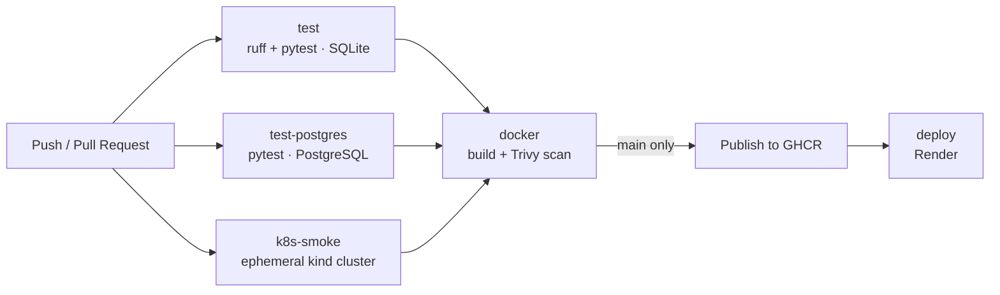

# Tasks API · End-to-end CI/CD

[](https://github.com/carlos-vi/tasks-api-cicd/actions/workflows/ci.yml)


A task-management REST API built as a **CI/CD learning project**. The application is deliberately simple: what matters is the complete cycle around it, from a `git push` to a production deployment, going through tests, security scanning, containers and orchestration.

## What this project demonstrates

- **Continuous integration** with GitHub Actions: lint, tests against SQLite and a real PostgreSQL, and a deployment smoke test on an ephemeral Kubernetes cluster.
- **Containers** with Docker: a custom image, layer-cached builds and a complete environment with Docker Compose.
- **Pipeline security**: image vulnerability scanning with Trivy before publishing.
- **Continuous delivery**: the image is published to GitHub Container Registry and automatically deployed to Render.
- **Team workflow**: protected `main` branch, changes through *pull requests* and required checks.
- **Kubernetes**: manifests for the API (2 replicas, health probes) and PostgreSQL with persistent storage.
- **A simple web UI** (HTML, CSS and dependency-free JavaScript) served by the API itself at `/`.

## Pipeline architecture



On a *pull request* the tests and the scan run, but **nothing** is published or deployed. Those two actions only happen when the code reaches `main`.

## Stack

| Layer | Technology |
|---|---|
| API | Python 3.11 · FastAPI · Uvicorn |
| Persistence | SQLAlchemy 2.0 · SQLite (default) · PostgreSQL 16 |
| Tests and quality | pytest · Ruff |
| Containers | Docker · Docker Compose |
| Orchestration | Kubernetes (manifests in `k8s/`) |
| CI/CD | GitHub Actions · Trivy · GitHub Container Registry |
| Deployment | Render (web service + managed PostgreSQL) |

## API

Interactive documentation (Swagger UI) at `/docs`.

| Method | Path | Description |
|---|---|---|
| `GET` | `/` | Web UI to view and create tasks |
| `GET` | `/health` | Health check. Returns `{"status": "ok"}` |
| `GET` | `/tasks` | Lists all tasks |
| `POST` | `/tasks` | Creates a task. Body: `{"title": "text"}` (1 to 200 characters). Returns `201`, or `422` if the title is not valid |

The web UI (`app/static/`) is mounted at `/` **after** the API routes, so `/health`, `/tasks` and `/docs` always take priority. Since it lives on the same server as the API, it calls `/tasks` with a relative path and needs no per-environment configuration.

## Getting started

### Requirements

- Python 3.11
- Docker (for the container options)
- Kubernetes enabled in Docker Desktop and `kubectl` (only for the Kubernetes option)

### 1. Locally, without Docker

```bash
python -m venv .venv
source .venv/bin/activate          # Windows: .venv\Scripts\activate
pip install -r requirements.txt
uvicorn app.main:app --reload
```

The API is available at <http://localhost:8000/docs>. With no extra configuration it uses SQLite (a `tasks.db` file).

### 2. Tests and linter

```bash
python -m pytest
python -m ruff check .
```

By default the tests use in-memory SQLite. To run them against PostgreSQL, set `DATABASE_URL` (see [Configuration](#configuration)).

### 3. With Docker

```bash
docker build -t tasks-api .
docker run -p 8000:8000 tasks-api
```

### 4. With Docker Compose (API + PostgreSQL)

```bash
cp .env.example .env               # Windows: copy .env.example .env  (and change the password)
docker compose up -d --build
```

It starts two connected containers: the API and PostgreSQL, the latter with a volume so the data survives restarts.

```bash
docker compose down                # stops and removes the containers; the data is kept
docker compose down -v             # same, but it also DELETES the data
```

### 5. With Kubernetes

The manifests are in [`k8s/`](k8s/). The *Secret* with the credentials is **not** versioned (the repository is public) and is created with a command.

```bash
docker build -t tasks-api:local .
kubectl apply -f k8s/00-namespace.yaml
kubectl create secret generic postgres-credentials -n tasks \
  --from-literal=POSTGRES_USER=tasks \
  --from-literal=POSTGRES_PASSWORD=<password> \
  --from-literal=POSTGRES_DB=tasks
kubectl apply -f k8s/10-postgres.yaml -f k8s/20-api.yaml

kubectl port-forward svc/api 8080:80 -n tasks    # API at http://localhost:8080/docs
kubectl delete namespace tasks                   # removes everything
```

## Configuration

The application is configured with environment variables.

| Variable | Purpose | Default |
|---|---|---|
| `DATABASE_URL` | Database to connect to. Accepts `sqlite://...`, `postgresql://...` and `postgres://...` | `sqlite:///./tasks.db` |
| `POSTGRES_USER`, `POSTGRES_PASSWORD`, `POSTGRES_DB` | PostgreSQL credentials in Docker Compose (`.env` file) | See `.env.example` |

If `DATABASE_URL` starts with `postgres://` or `postgresql://`, the application internally rewrites it to `postgresql+psycopg://`, which is the format of the driver it uses.

## CI/CD pipeline

The workflow is in [`.github/workflows/ci.yml`](.github/workflows/ci.yml).

| Job | When | What it does |
|---|---|---|
| `test` | Push to `main` and pull requests | Ruff and pytest with SQLite |
| `test-postgres` | Push to `main` and pull requests | The same test suite against a real PostgreSQL (*service container*) |
| `k8s-smoke` | Push to `main` and pull requests | Creates a cluster with kind, deploys `k8s/` and checks `/health` through the Service |
| `docker` | After the three above | Builds the image, scans it with Trivy (fails on HIGH/CRITICAL vulnerabilities that have a fix) and, on `main` only, publishes it to GHCR |
| `deploy` | On `main` only, after `docker` | Notifies Render through a *deploy hook* so it pulls the new image |

**Actions secrets used:** `RENDER_DEPLOY_HOOK_URL`. Publishing to GHCR uses the temporary `GITHUB_TOKEN` that GitHub generates on every run.

## Deployment

- **Image:** `ghcr.io/carlos-vi/tasks-api-cicd`, tagged `latest` and with the commit hash.
- **Application:** a Render web service that runs the image above.
- **Data:** managed Render PostgreSQL, connected through the `DATABASE_URL` variable configured on the service itself. The data lives outside the container and survives every deployment.

## Workflow

The `main` branch is protected by a GitHub *ruleset*:

- You cannot push to it directly: every change goes through a *pull request*.
- The `test` and `docker` checks must pass to merge (the latter in turn depends on `test-postgres` and `k8s-smoke`).
- The branch cannot be deleted and its history cannot be rewritten.

```bash
git switch -c feature/my-change
# ...changes and commits...
git push -u origin feature/my-change
gh pr create
```

## Repository structure

```
.
├── app/
│   ├── main.py                 # FastAPI endpoints and UI mounting
│   ├── db.py                   # Database connection, model and table creation
│   └── static/                 # Web UI: index.html, app.js, style.css
├── tests/
│   ├── conftest.py             # Test client fixture
│   ├── test_main.py            # Endpoint and UI tests
│   └── test_db.py              # Tests for DATABASE_URL normalization
├── k8s/
│   ├── 00-namespace.yaml
│   ├── 10-postgres.yaml        # Service + StatefulSet with a persistent volume
│   └── 20-api.yaml             # Deployment (2 replicas) + Service
├── .github/workflows/ci.yml    # CI/CD pipeline
├── Dockerfile
├── docker-compose.yml
├── .env.example
└── requirements.txt
```

## Known limitations

- **The API and the UI have no authentication**: anyone with the URL can read and create tasks.
- **The UI is deployed together with the API**, in the same image: one cannot be updated without redeploying the other.
- **Tables are created on startup** (`create_all`), with no migration tool. To evolve the schema in production you would need to add Alembic. So that several replicas can start at the same time, the creation is protected with a PostgreSQL *advisory lock*.
- **SQLAlchemy is pinned to the 2.0 series**: 2.1 requires compiled modules that some Windows policies (application control) block.
- **Render's free-plan limits** apply to the deployment: the service is suspended after a period of inactivity and the free database expires after 30 days.
- **The image includes the development dependencies** (pytest, Ruff) because a single `requirements.txt` is installed.
